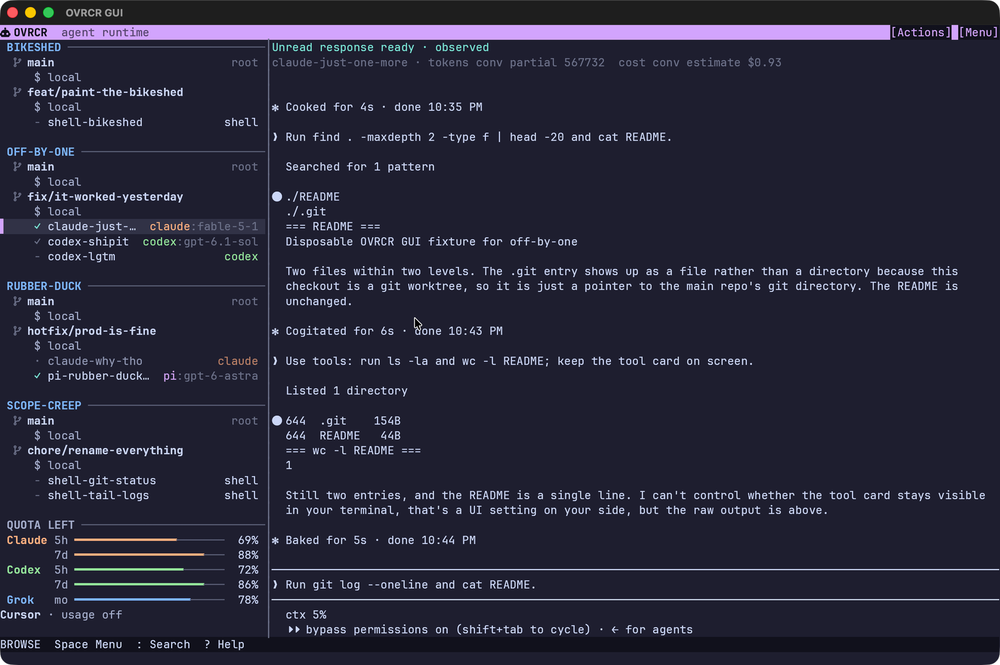
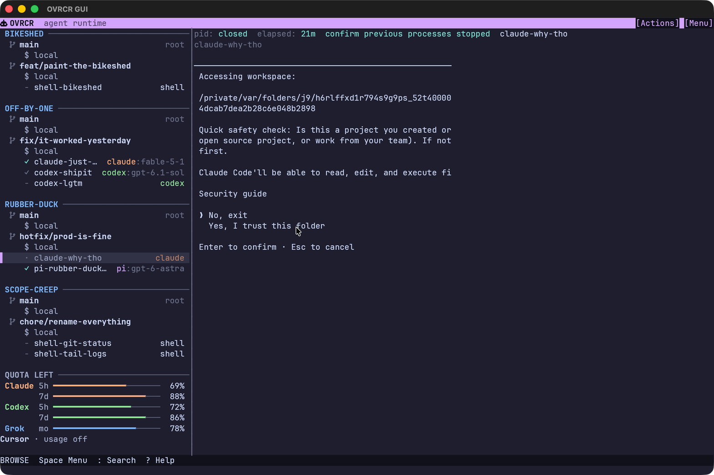
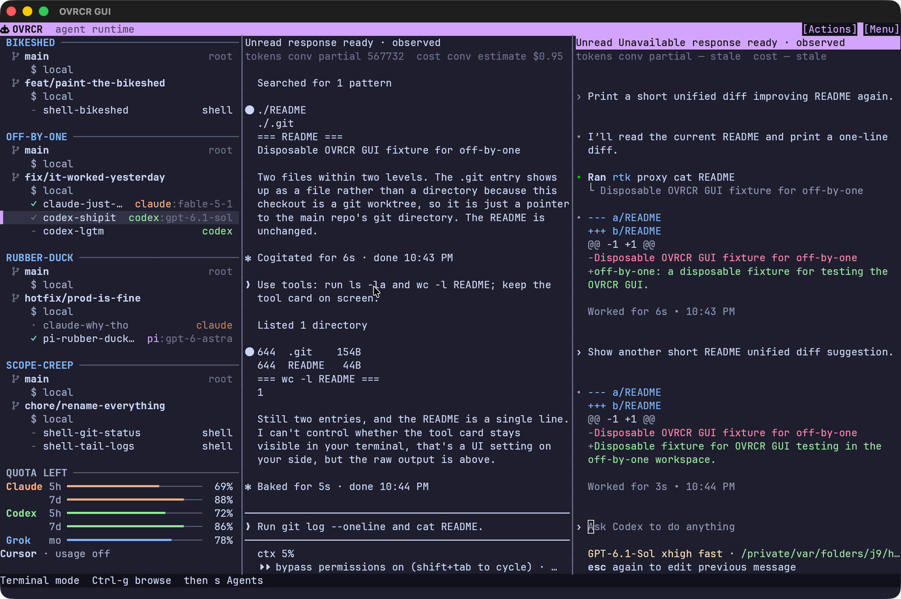

# OVRCR

**Yet another place to run coding agents. This one is Rust, so it’s fast and you get to feel smug about it.**

[](LICENSE)
[](https://www.rust-lang.org/)
[](#requirements)

## About

Agent runtimes and terminal multiplexers are everywhere. On a checklist they all look the same.

OVRCR is for a pile of coding-agent PTYs across a pile of worktrees. Register a Git repo, create a workspace (it makes the worktree), start Claude, Codex, Pi, Grok, Hermes, OMP, Cursor Agent, [Antigravity CLI](docs/agy-harness.md), or a shell. One Rust server owns the sessions. macOS also offers [Cursor cloud prompts and exact-run results](docs/cursor-cloud.md), with durable submission uncertainty and same-conversation idle follow-ups. Terminal responses, uncertain Retry and active reattachment remain blocked.

80 themes in Appearance, with 54 Dark and 26 Light choices. Catppuccin Mocha remains the default; the original eight palettes and saved theme IDs are preserved. See the [complete theme catalog](docs/themes/catalog.md).

## Screenshots

<p align="center">
  
</p>

<table>
  <tr>
    <td width="50%">
      
    </td>
    <td width="50%">
      
    </td>
  </tr>
</table>

## Why this instead of tmux + coping

- **Git-shaped.** Projects and worktree workspaces, not a flat session list. Creating a workspace creates the branch, the worktree, and (by default) a local shell. Dirty or foreign worktrees are refused.
- **PTYs outlive the UI.** `q` detaches the dashboard; agents keep running (and burning tokens). Reattach rebuilds from the live process.
- **Status is reported, not inferred.** Busy / waiting / Ready / context come from provider hooks. Silence is not idle. Reporting depth varies — see the [support matrix](docs/agent-reporting-support.md).

## Install

### macOS app

Install the native Dashboard from a checkout with Rust, just, and the Swift 6.3 Command Line Tools:

```sh
just install-app
open ~/Applications/OVRCR.app
```

You can also open **OVRCR** from Finder or the Dock. For development, run `just run-app` from the checkout. It refreshes the same debug CLI, Bridge assets, and Cursor SDK as `just run`, installs the matching Swift app in `~/Applications`, and runs it until you quit. `just app` builds and opens a release bundle in `target/`. The app starts or attaches to your regular OVRCR Server and shows your projects and sessions. Detach an open terminal Dashboard with `q` before switching. ⌘W hides the window. Reopening it from the Dock restores the Dashboard. ⌘Q detaches and leaves the Server and session processes running. **OVRCR → Settings…** (⌘,) saves the font and point size. Notifications use the optional Bridge.

### CLI and full installation

Build from source:

```sh
git clone https://github.com/xlyk/ovrcr.git
cd ovrcr
just install-release
ovrcr --version
```

`just install-release` builds and installs the CLI at `~/.local/bin/ovrcr`.
On macOS it also installs `~/Applications/OVRCR.app`, packages optional notification [Bridge](native/bridge/README.md)
startup assets into `~/.local/lib/ovrcr` and installs the pinned official Cursor
SDK archive into the separate `~/.local/lib/ovrcr-cursor-sdk/1.0.40` directory.
The first Cursor dependency install needs `python3`, `curl` and GitHub access;
set `OVRCR_CURSOR_BRIDGE_ARCHIVE=/absolute/official/archive.tar.gz` for an offline
install. A valid installed pin is reused. No bridge is executed during installation.
After installing a CLI any other way, run `just install-startup-assets` and,
for the experimental macOS Cursor cloud provider, `just install-cursor-bridge`.
Copy the printed absolute `bridge_archive` path into each account profile.
See [Cursor cloud setup and release limits](docs/cursor-cloud.md). Linux installs
the CLI without either macOS asset; Cursor cloud requires macOS Keychain.

Client and server must match on the wire protocol `ovrcr --version` prints.
Interactive startup offers to restart an older server (same protocol with a
different build, or an older protocol); live sessions stop if you accept.

## Quickstart

```sh
ovrcr project add myapp ~/Code/myapp --workspace-root ~/Code/workspaces/myapp
ovrcr workspace create --project myapp --new-branch feature/cleanup --base main
ovrcr new --project myapp --workspace feature/cleanup --name review -- claude
ovrcr
```

Dashboard: `j`/`k` select, `Enter` focus, `Space s` opens pane actions, `Ctrl-g` browse, `q` detach.

## Features

- Up to four panes with directional focus, swap, and zoom; Browse, Terminal, Copy, and History modes.
- [Built-in Operator](docs/operator.md): one persistent Pi conversation, streamed replies, native tools, and asynchronous coordination of visible Workspace Agent sessions.
- After server restart, retained rows reopen a fresh shell in place; certified Claude conversations can resume by UUID. Terminal output is not restored across server restart.
- 512 rows of scrollback; keyboard selection; OSC52 clipboard copy.
- Pause / resume via SIGSTOP / SIGCONT on the session process group.
- CLI with `--json` on every resource command.
- Optional remote web UI: `ovrcr remote serve`, started from `[remote] enabled` in Settings, with the bundled PWA and a Tailscale login gate. Start sessions on a registered workspace with a detected agent and an optional prompt, then watch, reply, pause, or kill.
- Optional: scheduled Pi tasks in fresh worktrees; macOS Bridge notifications.
- Theme pick list in Settings (or `theme` in `dashboard.toml`). Hot-swaps without restart. Does not fix your agents.

## Requirements

- macOS or Linux
- Rust 1.97.1 or newer (edition 2024)
- Git
- Optional: installed Pi 0.87.1 for [Operator](docs/operator.md) and [scheduled tasks](docs/scheduled-tasks.md); macOS [Bridge](native/bridge/README.md) for notifications

## Docs

- [Dashboard](docs/dashboard.md) — modes, keys, notifications, quota, events
- [Built-in Operator](docs/operator.md) — dedicated Pi setup, Workspace coordination, history and Stop
- [CLI reference](docs/cli-reference.md)
- [Agent reporting](docs/agent-reporting.md) · [Claude setup](docs/claude-code-setup.md) · [Support matrix](docs/agent-reporting-support.md)
- [Scheduled tasks](docs/scheduled-tasks.md) · [Provider quota](docs/provider-quota.md)
- [`AGENTS.md`](AGENTS.md) — invariants for contributors and coding agents

## Contributing

Start with [`AGENTS.md`](AGENTS.md), then open an issue or PR.

```sh
cargo test -p ovrcr
```

## License

OVRCR is licensed under the MIT License. See [`LICENSE`](LICENSE).

Cursor cloud live terminals accept `/cancel` for durable exact-run cancellation
intent. `ovrcr terminal cloud-cancel ID` closes local delivery; `cloud-discard ID`
separately retires saved private content. RPC acknowledgement is not proof that
remote work stopped; see [cloud controls](docs/cursor-cloud.md#cancel-and-discard).
