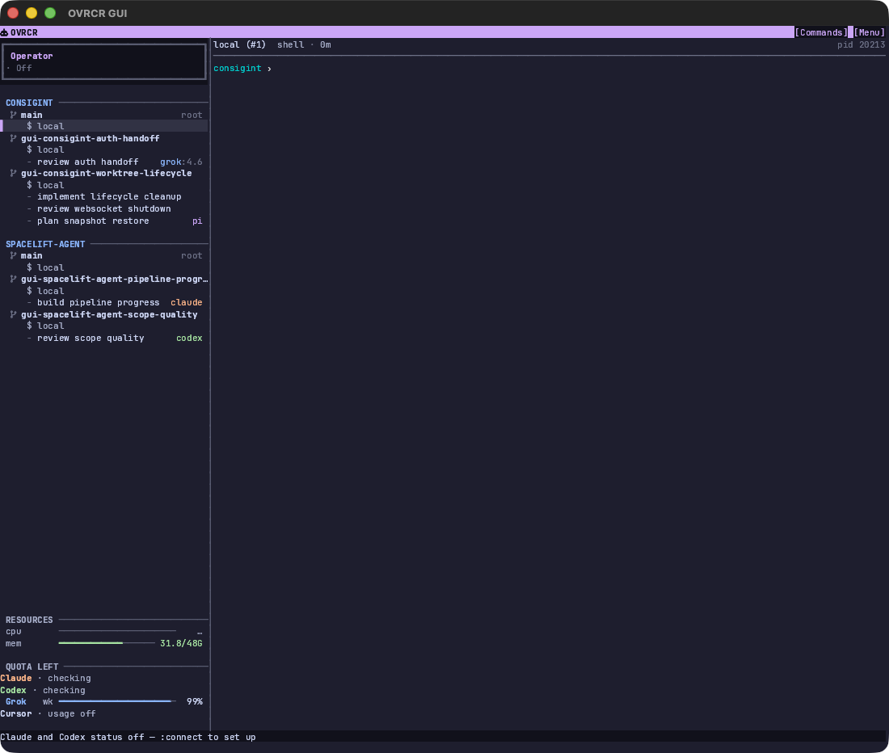

# Operator sidebar prototypes

Throwaway HTML prototypes for the Operator section. Four structures share one
39-column sidebar, the same five states, and a sidebar with no Usage section.

Open [index.html](index.html) in a browser. Switch with `←` / `→`, the bottom
bar, or the links below:

- `?variant=A` — **Command card.** Rail, glyph, identity and state on a tinted
  two-row card. Strongest identity; closest to the current direction.
- `?variant=B` — **Status strip.** State leads, identity follows; one quiet row
  with hairlines. Best if the Operator should stop competing with project
  headings.
- `?variant=C` — **Command tile.** A bordered two-row tile. Medium identity,
  no keycap; best if the section should read as a distinct surface.
- `?variant=D` — **One line.** A single prompt-style row. Maximum density; the
  tree gets the most rows, at the cost of identity.

Add `&state=off|idle|working|unread|setup` and `&selected=1` to inspect states.
The top buttons set them too.

## Tradeoffs

| Variant | Rows | Identity | Density |
| --- | --- | --- | --- |
| A Command card | 2 | Strongest | Medium |
| B Status strip | 1 | Quiet | High |
| C Command tile | 2 | Medium | Medium |
| D One line | 1 | Light | Highest |

Keyboard-shortcut copy is deliberately absent. The unread state also drops the
right-aligned age in every variant so `Reply ready · 1 unread` stays on one line
at 39 columns.

This is a design artifact; the winning structure still needs a Rust TUI
implementation and tests.
