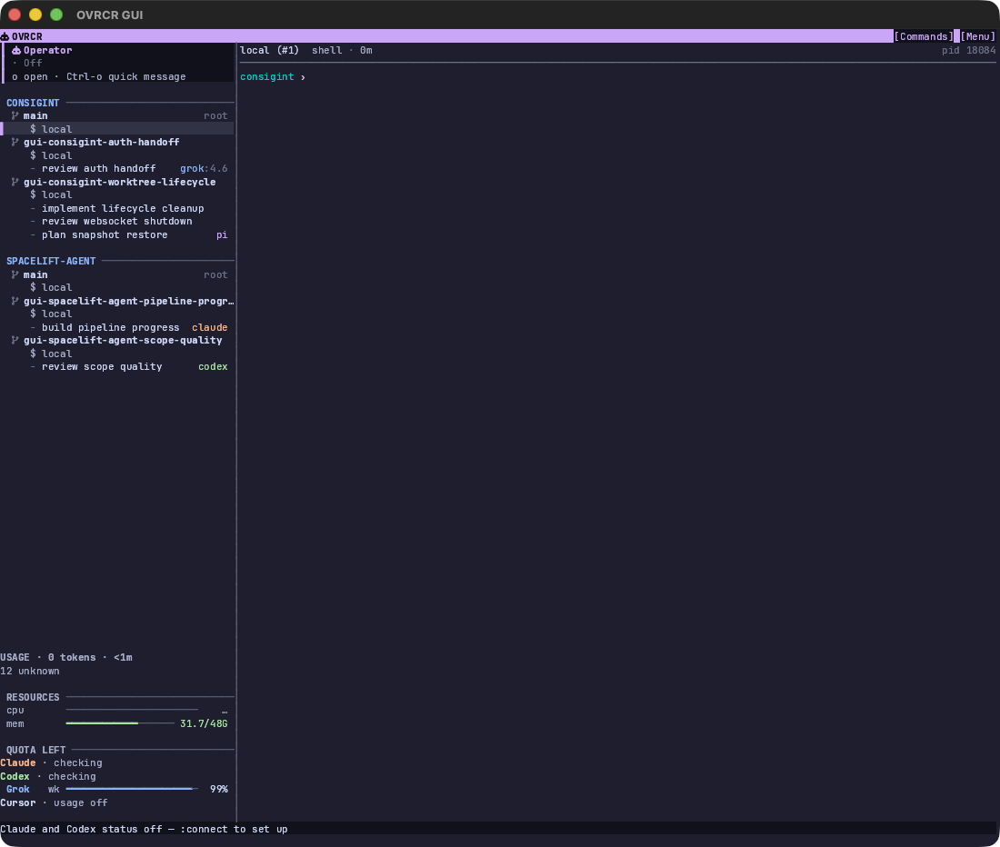
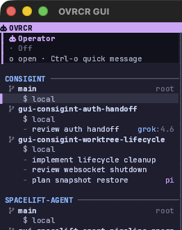
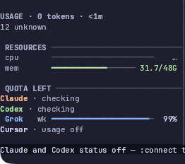

# Sidebar Usage and Operator pass — 2026-11-13

Tested checkout: `/Users/xlyk/Code/ovrcr-sidebar-pass`, branch
`feat/sidebar-usage-operator`, based on `56ef76943`, working tree modified.
macOS, Apple silicon, OVRCR GUI helper.

## Native run

`rtk proxy just gui` from this checkout built `target/OVRCR GUI.app` and ran a
disposable demo server. After dismissing the startup offer, the dashboard showed
the Operator card and the compacted Usage section.

Observed:

- The Operator section is now a tinted card with a `┃` rail, robot glyph and
  mixed-case `Operator` identity. It has no project rule. The status line shows
  `Off` with the `o open · Ctrl-o quick message` hint. It does not echo a
  conversation/reply title.
- Usage shows only counters with sessions. The demo has `12 unknown`, so the
  section is two lines: the server-lifetime heading and `12 unknown`. Zero
  counters are absent.
- Resources, quota, tree and footer geometry remain readable at the helper's
  default size.

The GUI input path was a CoreGraphics key sender addressed to the GUI PID; the
startup offer was answered with `n`, Return. `osascript` accessibility text was
unavailable (`osascript is not allowed assistive access`), so this pass records
pixels and the host's own tests, not an AX transcript. A full Codex/CUA pass is
still required for input-focused acceptance; the previous guide records that
Codex CUA was unavailable on this host.

## Title investigation (no code change in this pass)

The live instance's `dashboard.toml` sets
`title_model = "deepseek/deepseek-v4-flash"`. Title calls failed with
`Pi rejected the prompt: No API key found for deepseek`; the retained
`conversation_subjects` rows for the affected sessions have empty topics and
three recorded attempts, which closes their title windows.

The constraint is the title call's own isolation flags: it runs Pi with
`--no-extensions`. Pi 0.87.1 therefore exposes only `openai-codex` and `xai`
without extensions. `ollama-cloud` (and its `deepseek-v4.1-flash` model) is
provided by an installed Pi package and is not available to the call. A title
probe using the same flags with `openai-codex/gpt-6.1-sol` returned a usable
topic, so that spelling is a working value. Existing closed conversations need
a new conversation (or a deliberate retained-store reset) to receive a title;
changing the model alone does not reopen them. The stable-titles documentation
now names the no-extensions provider constraint.

## Automated checks

- `cargo test -p ovrcr-tui --lib -- --test-threads=1`: 485 passed.
- `cargo test -p ovrcr --test tui`: 529 passed.
- `cargo fmt --all -- --check`: clean.
- `cargo clippy --workspace --all-targets --all-features -- -D warnings`: clean.
- `cargo test --workspace --all-targets --all-features` reaches unrelated host
  flakiness: `agent_hook_cli_timeout_is_bounded` fails on unmodified `main` on
  this loaded host, and `context_helper_*`/`leased_tool_timeout_*` pass alone but
  timed out or saw a worker go unlive under full-suite load. The focused TUI
  suites above are green. No changed TUI assertion failed.

## Cleanup

The GUI was stopped by signal because the AX close path was unavailable; the
launcher exited, and the disposable Server was stopped separately. The
task-owned root `$TMPDIR/ovrcr-gui-azheek` was then removed after confirming no
owned process remained.
