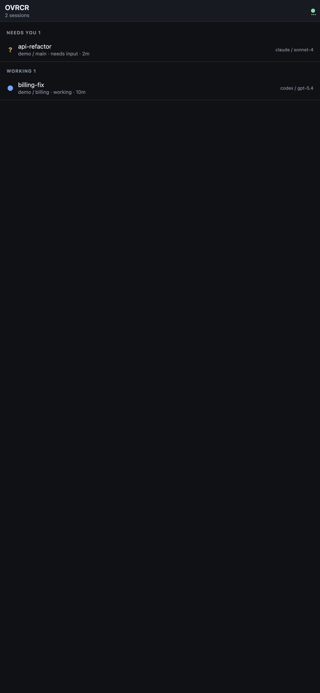
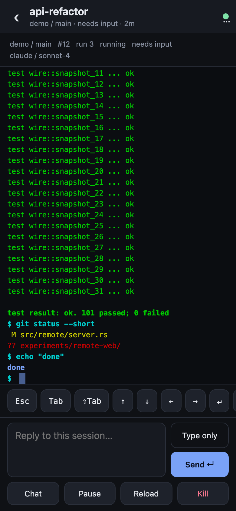
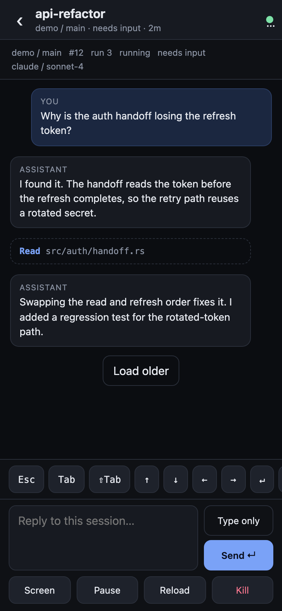
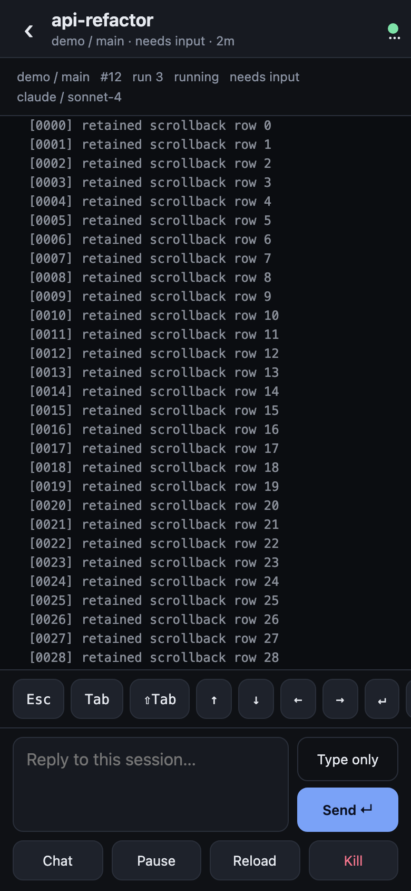

# OVRCR remote web (MVP)

A browser UI for OVRCR, sized for a phone: session inbox, colored terminal with
scrollback, key bar, reply box, and the agent transcript. It is a Control client
— it never takes the Dashboard seat, resizes a PTY, or changes focus, so the
desktop TUI can stay attached.

The installed product is **`ovrcr remote serve`** (Rust): it speaks the socket
protocol directly and embeds the PWA from `public/`. This Node app is the
original prototype; it remains useful for iterating on the page without
rebuilding the CLI, but it is not what the Server supervises.

Tailscale is optional. Without it the app is a loopback-only UI; with it,
`tailscale serve` adds private HTTPS for a phone. Nothing in the code requires
Tailscale, and no tailnet values are hard-coded.

Status: working locally, over a private tailnet, and as a settings-driven child
of the Server. Slice 0 of
[`plans/2026-11-06-mobile-remote-web.md`](../../plans/2026-11-06-mobile-remote-web.md),
extended with read-only screen-window and transcript requests (protocol 73).

## Architecture

```
phone browser (PWA)
   │ HTTPS, tailnet only
   ▼
tailscaled ── tailscale serve ──► 127.0.0.1:8787   [this app, Node]
                                         │ argv, one CLI process per request
                                         ▼
                                   ovrcr CLI ──► server.sock ──► sessions
```

The app owns no session state. It spawns the installed `ovrcr` CLI and returns
JSON to the page. The Server remains the one owner of the PTYs.

## Server-managed mode

In the rebuilt CLI, `[remote]` in `dashboard.toml` is the source of truth:

```toml
[remote]
enabled = true
port = 8787
login = "you@example.com"   # optional; empty keeps it loopback-only
```

The Dashboard's Settings view exposes the same three rows. Enabling the toggle
starts `ovrcr remote serve` as a supervised child of the Server; disabling it
stops the child. A port or login change restarts it. The choice persists across
Server restarts, and the child is stopped when the Server stops. Start, stop and
failure lines are Events under the `remote` component; the child writes
`remote.log` in the instance directory.

`ovrcr remote status --port 8787` probes whether it is listening.

## Starting a session

Tap **+** on the session list. Pick a registered project and workspace, then one
of the agents detected on the Server's `PATH` (or Shell). The optional initial
prompt is passed at launch for Claude, Codex, Pi, Oh My Pi and Grok; other agents
open without it and the sheet says so. The optional name is the session name;
leave it empty to generate one from the workspace.

The page sends only `{project, workspace, agent, prompt, name}` to
`POST /api/session`. The gateway resolves the agent to argv and asks the Server
to create the session; arbitrary commands are not accepted.

## Requirements

- Node 22 (no npm dependencies).
- **Protocol 72** on both sides: the CLI this app spawns and the running Server.
  Building this branch gives you both, but the Server must restart before the
  new commands exist, and a restart stops live sessions.

```sh
cargo build -p ovrcr --bin ovrcr
# stop the old Server, then start it from the rebuilt CLI
```

If the CLI predates `terminal screen`, the gateway falls back to
`terminal read`: plain text, no scrollback, no cursor.

## Run the prototype

```sh
cd experiments/remote-web
OVRCR_REMOTE_LOGIN=you@example.com node server.mjs
```

For the product, build the CLI and use `ovrcr remote serve --port 8787 --login
you@example.com`, or enable `[remote] enabled` and let the Server start it.

Open <http://127.0.0.1:8787>. It talks to the instance the CLI resolves
(`OVRCR_HOME`, or the default config directory), so it **reads and writes your
live sessions**. `Ctrl-C` stops it.

No Tailscale, no environment file, no config: this is the whole local setup.
`OVRCR_REMOTE_LOGIN` is only needed when a proxy is in front (below); without
it, any request that does not carry a loopback `Host` is refused.

| Variable | Default | Meaning |
| --- | --- | --- |
| `PORT` | `8787` | Listen port |
| `HOST` | `127.0.0.1` | Refused unless loopback, or `ALLOW_REMOTE=1` |
| `OVRCR_BIN` | `ovrcr` | CLI to spawn |
| `LIST_TTL_MS` | `5000` | Inventory cache; `terminal list` runs Git per workspace |
| `OVRCR_REMOTE_LOGIN` | unset | Optional. Tailscale login allowed through Serve; unset refuses all non-loopback requests |

## Optional: reaching it from a phone (Tailscale)

The app binds loopback; `tailscale serve` terminates TLS on the tailnet and
proxies to it. Substitute your own node name and login.

```sh
OVRCR_REMOTE_LOGIN=you@example.com PORT=8787 node server.mjs
tailscale serve --bg --yes --https=443 http://127.0.0.1:8787
tailscale cert <machine>.<tailnet>.ts.net   # once, see below
open https://<machine>.<tailnet>.ts.net
```

### One-time tailnet setup

1. **Enable Serve.** If the command prints `Serve is not enabled on your
   tailnet`, open the printed link in the admin console and confirm. This is an
   account-level toggle, not a daemon setting.
2. **Issue the certificate.** Enabling Serve does not always provision the TLS
   cert. If the browser gets a TLS error (`tlsv1 alert internal error` in curl),
   run `tailscale cert <machine>.<tailnet>.ts.net` once. tailscaled renews it
   afterward.
3. **Grant the port in the ACL.** A restrictive tailnet policy drops the
   phone's packets even though the machine is visible and `tailscale ping`
   works. Add, merging into the existing `grants` (or `acls`) array:

```json
{
  "grants": [
    { "src": ["you@example.com"], "dst": ["<machine>"], "ip": ["tcp:443"] }
  ]
}
```

Merging matters: replacing the policy file removes existing rules (`tag:*`,
LAN ranges, SSH). `tailscale debug netmap` showing `PacketFilter: []` means no
data traffic is allowed; a working grant appears as one rule for the node on
443.

### How the gate works

`tailscale serve` injects `Tailscale-User-Login` from WhoIs and strips a
client-supplied copy. With `OVRCR_REMOTE_LOGIN` set, any request whose `Host` is
not loopback must carry that exact login; local requests still work. Mutating
requests must also carry a matching `Origin`. Without the variable, every
non-loopback request is refused with 403.

Never use `tailscale funnel`; it is public and drops identity headers. Remove
the mapping with `tailscale serve reset`.

### Troubleshooting

| Symptom | Cause | Fix |
| --- | --- | --- |
| Phone times out; `tailscale ping` works | ACL has no grant; tailscaled logs `Drop: TCP{...} 60 no rules matched` | Add the grant above |
| `Serve is not enabled on your tailnet` | Account toggle off | Open the printed admin link |
| TLS `internal error` / cert warning | Cert not issued | `tailscale cert <name>` |
| HTTP 403 from the app | Wrong/missing login, or bad `Origin` | Check `OVRCR_REMOTE_LOGIN`; use the ts.net host |
| HTTP 502 | CLI missing or protocol mismatch | Rebuild/install the CLI; restart the Server |
| Screen shows "no live terminal" | Retained row, not running | Reopen the session on the desktop |
| Tofu glyphs | Font not served | Check `/fonts/*.woff2` return 200 |

Diagnose with `tailscale debug daemon-logs` on the Mac: it prints the dropped
5-tuple and the reason.

None of this is required to use the app. The login gate is inert until
`OVRCR_REMOTE_LOGIN` is set; the Serve mapping and ACL live outside this repo
and can be removed with `tailscale serve reset` without touching the app.

### Phone

Install Tailscale, sign in to the same tailnet, confirm Connected, then open
`https://<machine>.<tailnet>.ts.net` and use **Add to Home Screen**. HTTPS makes
it a proper PWA.

## What works

- Inbox grouped Needs you / Working / Idle / Ended, from
  `ovrcr terminal list --json`: activity, unread, run, agent label, elapsed.
- **Colored screen** from `ovrcr terminal screen --json`: per-cell text, width,
  `Default | Indexed(u8) | Rgb` foreground and background, and the
  bold/dim/italic/underline/inverse attribute bits. This includes the 256-color
  palette and truecolor.
- **Scrollback**: the Server retains 512 rows; the view loads the tail first and
  fetches a window when you scroll into unloaded rows. The cursor is drawn when
  the window includes the live screen.
- **Transcript** from `ovrcr terminal transcript --json`: user, assistant and
  tool entries with a "Load older" page button. Claude and Codex only, because
  that is what the Server can read.
- Key bar: Esc, Tab, Shift-Tab, arrows, Enter, Ctrl-C, 1, 2, y, n.
- Reply box: `Send` pastes and presses Enter; `Type only` pastes without Enter.
- Mark reviewed, pause, resume, kill; deep link `#/s/12`.
- The desktop Dashboard can stay attached. This app is a Control client.

## Fonts

The terminal uses **JetBrains Mono Nerd Font Mono**, bundled as WOFF2
(`public/fonts/`, regular, bold, italic and bold italic) so a phone does not
need the font installed. It covers Nerd Font private-use glyphs, Powerline
separators, box drawing and block elements; without it those cells render as
tofu.

Rows are 16px for a 12px face. That is the font's own cell height: JetBrains
Mono's ascent plus descent is 1.32em, so 12 × 1.32 = 15.84. Matching it keeps
block and Powerline glyphs tiled vertically. Ligatures and font synthesis are
disabled on the terminal grid because the layout assumes one advance per cell.

The files are WOFF2 conversions of `JetBrainsMonoNerdFontMono` from
[Nerd Fonts](https://github.com/ryanoasis/nerd-fonts), a patched build of
[JetBrains Mono](https://github.com/JetBrains/JetBrainsMono). Copyright 2020 The
JetBrains Mono Project Authors, SIL Open Font License 1.1. The full license is
in `public/fonts/OFL.txt`.

The page preloads the upright and italic faces, `font-display: block` avoids a
tofu flash, and the server marks the fonts immutable for a day. Glyphs the font
does not contain (emoji, CJK) fall back to the system font, where column widths
can differ.

## Limits

- **Alternate-screen sessions have no scrollback.** The Server's history path
  refuses them, so the window reports `history_rows: 0` and only the live screen
  is shown. Most full-screen agent TUIs are in this class; their history is the
  transcript view, not terminal rows.
- Scrollback row numbers are positions in a 512-row ring. When the ring evicts
  old rows, the same number names different text; the page clears its cache when
  `history_rows` shrinks, but a stale row can survive a long scroll.
- A window is at most 128 rows by 256 columns per request. Tall desktop windows
  that show more than that leave a gap at the top until you scroll.
- **Resize does not reflow the PTY.** The browser re-renders the fixed grid; a
  real re-layout needs `TIOCSWINSZ`, and that authority belongs to the
  Dashboard. See the memo's "Deferred: resize".
- Transcript text is the provider's, verbatim; the UI renders it with
  `textContent`, never as HTML.
- `send` has no run fence; the UI never retries a failed send.
- The web process is session-owned right now: if it dies, Serve returns 502.
  There is no launchd unit yet.
- No notifications, settings, workspace creation, or per-device pairing tokens.

## Security boundary

- Binds `127.0.0.1` only; refuses any other host unless `ALLOW_REMOTE=1`.
- Behind Serve, requires the configured Tailscale login on every non-loopback
  request and a matching `Origin` on mutations.
- Spawns with an argv array, never a shell. Session ids must be positive u64;
  keys must look like `:escape:`; text is capped at 32k characters; bodies at
  64 KiB.
- Logs method, path, status, and duration. Never request bodies, terminal text,
  keys, or transcript content.
- CSP `default-src 'self'`, `no-store`, `no-referrer`, `nosniff`, `font-src
  'self'`; server text is written with `textContent`.
- Residual risk: any device signed in as the configured login passes the gate,
  and there is no per-device token or read-only unlock yet. Removing the phone
  from the tailnet is the kill switch. Tailscale Funnel is never used.

## Tests

```sh
npm test           # 17 tests: HTTP, paging args, caching, validation, auth gate, error mapping
npm run test:live  # real ovrcr server against a disposable empty instance
```

`npm test` uses `test/stub-ovrcr.mjs`, which records argv and returns canned
JSON; it never touches a real instance. The gate tests drive raw `Host`,
`Tailscale-User-Login`, and `Origin` headers. `npm run test:live` creates a
temporary `OVRCR_HOME`, starts a real `ovrcr server`, asserts an empty inventory,
and shuts it down.

Rust coverage: `page_rows` unit tests in
`crates/ovrcr-terminal/src/history.rs`, the wire snapshot in
`crates/ovrcr-protocol/src/wire.rs`, the settings matrix in
`crates/ovrcr-runtime/tests/settings_matrix.rs`, and the autostart lifecycle in
`tests/remote_web.rs` (real Server, disposable instance, toggle on and off). A
full PTY round trip is still manual: this build sandbox has no PTY devices.

## Browser check

Screenshots use Chrome DevTools device emulation at 390×844 with a 2× scale.
`--window-size` cannot reach phone widths headlessly on macOS; use
`Emulation.setDeviceMetricsOverride` or a 390px iframe.

| Inbox | Session |
| --- | --- |
|  |  |

| Transcript | Scrollback |
| --- | --- |
|  |  |

## Files

- `server.mjs` — loopback HTTP server, CLI runner, routes, validation, gate.
- `public/` — `index.html`, `styles.css`, `app.js`, `fonts/`; no external assets.
- `test/stub-ovrcr.mjs` — argv-recording CLI stub.
- `test/server.test.mjs` — the 17 tests.
- `test/live-instance.mjs` — real server, empty instance.

## Next

1. A launchd/systemd unit for the web process (Serve is already independent).
2. Per-device pairing plus a read-only default, so a tailnet login is not the
   only gate.
3. Port the backend to an `ovrcr remote` subcommand that speaks the protocol
   directly (no CLI spawns, `Events { follow }` push). The PWA and HTTP shape
   stay.
