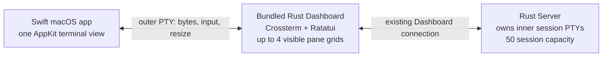

# OVRCR Swift app: grilling results and terminal research

Recorded 2026-11-13. The product concept below was confirmed through four grilling rounds. The terminal-engine recommendation comes from subsequent source research and remains subject to native acceptance testing. This document records design and research; it does not authorize implementation or migration.

For the subsequent build, native test results, and remaining adoption checks, see the [prototype progress report](swiftterm-prototype-progress.md).

- [Grilling results](#grilling-results)
- [Terminal recommendation](#terminal-recommendation)
- [Terminal comparison](#terminal-comparison)
- [Acceptance matrix](#acceptance-matrix)
- [Supporting research notes](#supporting-research-notes)

## Grilling results

The goal is one Swift macOS app with a TUI experience reminiscent of MacVim or Neovide. Almost all of the current OVRCR workspace should retain its layout and behavior, closely resembling the GUI TUI used for visual testing. The app should improve Mac integration, text/input quality, and access to native capabilities while preserving the existing Rust session engine.

| Round / question | Decision | Confirmed answer |
|---|---|---|
| 1 / Q1 | Main benefit | All three: one coherent Mac app, better TUI rendering/input, and freedom to add richer native features. Kyle answered: “all of the above.” |
| 1 / Q2 | Platform scope | macOS is primary. Retain existing terminal/Linux access as secondary, without promising parity for every future Mac feature. |
| 1 / Q3 | TUI boundary | Preserve almost all current TUI layout and behavior. Kyle answered: “almost all of the TUI and the current app should stay how it is now. it would be really similar to the GUI TUI that we use for testing visually.” |
| 2 / Q4 | Rendering boundary | Swift hosts the existing Rust Dashboard in an embedded terminal view. Keep the current TUI rather than move workspace rendering into Swift. |
| 2 / Q5 | Window and process lifecycle | Closing the window hides it while the app and notifications remain alive. Cmd-Q stops the GUI and its notifications while Rust Server-owned sessions continue. |
| 2 / Q6 | Installation and updates | One self-contained `.app` bundles matching Rust components and owns macOS installation/updates. Retain optional CLI access. |
| 3 / Q7 | Frontend ownership | Quit the Mac app before attaching the interactive terminal Dashboard. Keep one active Dashboard; ordinary CLI control commands remain usable while the app runs. No automatic takeover or new handoff flow is planned. |
| 3 / Q8 | Keyboard ownership | Native Cmd shortcuts handle app commands, copy/paste, font zoom, and windows. Preserve Ctrl-based TUI and agent shortcuts, including Ctrl-C interrupt. |
| 3 / Q9 | Initial polish | Prioritize crisp text, font zoom, correct keyboard/IME input, selection, clipboard, scrolling, and focus. Defer animation. |
| 4 / Q10 | Shared understanding | Kyle confirmed the complete concept: “Yes, this captures it.” Confirmation concluded the brainstorm and explicitly excluded implementation and migration. |

### Confirmed app boundary

- Swift owns the Mac window, native menus, Cmd shortcuts, clipboard integration, font zoom, notifications, and activation.
- The embedded terminal hosts the existing Rust Dashboard. Rust retains workspace behavior, the independent Server, session ownership, and the 50-session capacity.
- Closing the window keeps the app available; Dock activation or a notification restores the UI. Quitting detaches the frontend while sessions survive.
- Keep existing History/Copy workflows and terminal control keys. Host selection and scrolling must coexist with those workflows.
- Richer Mac features may follow without redesigning the workspace. Native panels, animations, or additional product features were not specified in this brainstorm.

### Research recommendation versus confirmed decisions

The grilling settled the embedded-terminal architecture, not a particular terminal engine. Subsequent research recommends SwiftTerm at the pinned candidate revision below, with full Ghostty as a fallback if required quality gates fail. Neither the engine's native quality nor its adoption has been confirmed by an app build or runtime test.

## Terminal recommendation

Choose SwiftTerm’s public AppKit `TerminalView` as the first feasibility candidate for OVRCR’s Swift macOS app, pinning the inspected upstream commit `d4f52faaae413b2e69c728ad79cd225cdbebc042` rather than following a floating branch or assuming the latest release is sufficient. Its native view and byte-source/PTY boundary can host the existing Rust Dashboard while the Rust Server continues to own workspaces, live sessions, and the 50-session limit. That is the best balance of direct AppKit integration and preserving OVRCR’s TUI, but it is a **conditional recommendation**: exact OVRCR keyboard/IME behavior, composition-overlay rendering, font zoom, accessibility, and lifecycle have not been validated in an OVRCR app. If SwiftTerm fails those quality gates, full Ghostty is a credible alternative with an existing macOS renderer, but only if OVRCR accepts maintaining a pinned internal API and its build/resources; `libghostty-vt` alone is not a terminal view. This is a source/API synthesis dated 2026-11-13, not native-app or performance evidence. ([SwiftTerm v1.99.3 release](https://github.com/migueldeicaza/SwiftTerm/releases/tag/v1.99.3), [inspected SwiftTerm commit](https://github.com/migueldeicaza/SwiftTerm/commit/d4f52faaae413b2e69c728ad79cd225cdbebc042), [Ghostty embedder header](https://github.com/ghostty-org/ghostty/blob/46f1cea1a10a19bef97a8a0f5948e660d0b74fe2/include/ghostty.h#L1-L10))

## One native terminal view can preserve Rust ownership

The planned app needs one outer terminal for one Rust Dashboard process. With no CLI subcommand, OVRCR connects to its Server and runs the Dashboard in a single Ratatui terminal; the Server separately owns provider PTYs and their parsed screens. The Dashboard supports up to four pane grids, constrained by window geometry, while the Server’s live-session capacity is 50. The Swift app therefore needs one terminal surface for the Dashboard, not a terminal view for every session. ([Dashboard startup and event loop](https://github.com/xlyk/ovrcr/blob/56ef7694318b5a1ec0514424b503dd2d004ff6a1/src/cli/mod.rs#L71-L80), [Server Dashboard ownership](https://github.com/xlyk/ovrcr/blob/56ef7694318b5a1ec0514424b503dd2d004ff6a1/crates/ovrcr-runtime/src/server/dashboard.rs#L1-L38), [session limit](https://github.com/xlyk/ovrcr/blob/56ef7694318b5a1ec0514424b503dd2d004ff6a1/crates/ovrcr-runtime/src/server/mod.rs#L256), [Dashboard pane layout](https://github.com/xlyk/ovrcr/blob/56ef7694318b5a1ec0514424b503dd2d004ff6a1/crates/ovrcr-tui/src/dashboard/mod.rs#L118-L137))

SwiftTerm offers both a public AppKit `TerminalView` for an arbitrary byte source and a `LocalProcessTerminalView` that creates a local process PTY. The app can launch its bundled Dashboard attach client inside that outer PTY; the Dashboard then uses OVRCR’s existing Server connection. The terminal engine does not need to attach to the Server’s already-owned inner session PTYs. ([SwiftTerm AppKit view and delegate](https://github.com/migueldeicaza/SwiftTerm/blob/d4f52faaae413b2e69c728ad79cd225cdbebc042/Sources/SwiftTerm/Mac/MacTerminalView.swift), [SwiftTerm local process view](https://github.com/migueldeicaza/SwiftTerm/blob/d4f52faaae413b2e69c728ad79cd225cdbebc042/Sources/SwiftTerm/Mac/MacLocalTerminalView.swift))

This boundary preserves the accepted product contract: the self-contained app bundles matching Rust components; closing the window hides it while the app and notifications remain alive; Cmd-Q ends the GUI and notifications while Server-owned sessions continue; and an interactive terminal Dashboard attaches only after the app quits. Ordinary CLI control commands remain available while the app is running. SwiftTerm supplies a terminal surface, not those app lifecycle rules or the one-Dashboard admission policy.

## Terminal comparison

| Candidate | What it brings to this app | Decision |
|---|---|---|
| **SwiftTerm** | Public Swift/AppKit `NSView`, arbitrary-source delegate, local process PTY option, AppKit text input, CoreText rendering, optional Metal renderer, and MIT license. | First feasibility candidate: it is the most direct way to wrap the unchanged Dashboard in a native view. Pin and test a specific revision; do not infer product quality from API presence. ([README](https://github.com/migueldeicaza/SwiftTerm/blob/d4f52faaae413b2e69c728ad79cd225cdbebc042/README.md), [package manifest](https://github.com/migueldeicaza/SwiftTerm/blob/d4f52faaae413b2e69c728ad79cd225cdbebc042/Package.swift)) |
| **Full Ghostty surface API** | A complete terminal engine with a macOS surface API for drawing, key/text/paste/preedit input, focus, resize, and launching a command. Its CoreText/Metal renderer gives it a serious native-fidelity case. | Conditional fallback if SwiftTerm misses required polish and OVRCR agrees to own a pinned integration. The API exists, but upstream labels it internal and says it is not designed for external use. cmux demonstrates a real external integration by pinning a Ghostty fork, building an XCFramework, and packaging resources; that proves feasibility, not upstream support or lower maintenance. Ghostty’s MIT engine license is separate from cmux’s GPL host code. ([surface API](https://github.com/ghostty-org/ghostty/blob/46f1cea1a10a19bef97a8a0f5948e660d0b74fe2/include/ghostty.h#L474-L517), [cmux build workflow](https://github.com/manaflow-ai/cmux/blob/b9eda4f5b5398edf3a1b8da7e7a3363bf3488a75/.github/workflows/build-ghosttykit.yml), [cmux Ghostty fork pin](https://github.com/manaflow-ai/ghostty/commit/ef4f1570d62117ebc51e3b0f07ad4f34032267b6), [Ghostty license](https://github.com/ghostty-org/ghostty/blob/46f1cea1a10a19bef97a8a0f5948e660d0b74fe2/LICENSE), [cmux license](https://github.com/manaflow-ai/cmux/blob/b9eda4f5b5398edf3a1b8da7e7a3363bf3488a75/LICENSE)) |
| **`libghostty-vt`** | Published Swift-compatible XCFramework and C ABI documented as stable from 1.0. Its terminal model tracks screen, scrollback, cursor, styles, and modes. | Not a direct-view substitute: it does not draw or manage a PTY. OVRCR would need its own renderer, shaping/layout, AppKit input host, selection/scrolling, and accessibility behavior—the work this choice is meant to avoid. ([installation and XCFramework](https://lib.ghostty.org/vt/installing.html), [terminal API](https://lib.ghostty.org/vt/group__terminal.html), [render state API](https://lib.ghostty.org/vt/group__render.html)) |
| **xterm.js in WKWebView** | A maintained terminal emulator with a possible local web frontend. | Secondary fallback only if SwiftTerm’s view is unsuitable and OVRCR accepts web-rendered text. Stable 6.0.0 typings do not expose the Kitty keyboard option present on current main; a reported CJK IME failure concerns a beta on Linux/X11 and does not prove WKWebView behavior. The host would still need a PTY bridge, packaged assets, clipboard, resize, and keyboard integration. ([xterm.js 6.0.0](https://github.com/xtermjs/xterm.js/releases/tag/6.0.0), [6.0 typings](https://github.com/xtermjs/xterm.js/blob/6.0.0/typings/xterm.d.ts), [current Kitty option](https://github.com/xtermjs/xterm.js/blob/master/typings/xterm.d.ts), [IME report](https://github.com/xtermjs/xterm.js/issues/6112)) |
| **libvterm or OVRCR’s vt100/egui path** | Terminal state parsing and an existing development GUI test harness. | Do not select as the app view: neither is a ready native terminal surface, and taking this route would make OVRCR own substantially more rendering and input polish. The egui harness proves a test path exists, not production Mac input fidelity. ([OVRCR GUI harness](https://github.com/xlyk/ovrcr/blob/56ef7694318b5a1ec0514424b503dd2d004ff6a1/src/gui.rs#L359-L385), [vt100 lock entry](https://github.com/xlyk/ovrcr/blob/56ef7694318b5a1ec0514424b503dd2d004ff6a1/Cargo.lock#L4598-L4602)) |

The Ghostty comparison is not “supported SwiftTerm versus impossible Ghostty.” Full Ghostty can host this child-process topology: its surface config accepts a command, environment, and working directory, and the API exposes the drawing and input operations an AppKit host needs. A child Dashboard PTY is enough; a callback for attaching to OVRCR’s inner PTYs is unnecessary. The cost is a private API contract and a downstream build/resource pipeline, as cmux’s pinned fork and XCFramework workflow show. By contrast, the upstream-supported VT library is deliberately lower-level. ([Ghostty surface config and API](https://github.com/ghostty-org/ghostty/blob/46f1cea1a10a19bef97a8a0f5948e660d0b74fe2/include/ghostty.h#L474-L517), [Ghostty external-embedding guidance](https://github.com/ghostty-org/ghostty/discussions/14360), [cmux resources](https://github.com/manaflow-ai/cmux/tree/b9eda4f5b5398edf3a1b8da7e7a3363bf3488a75/Resources/ghostty))

## Native quality and packaging risks

**Packaging.** SwiftTerm v1.99.3’s package manifest requires Swift tools 6.2 and declares macOS 11 as its minimum deployment version. Those are manifest declarations, not validated OVRCR support: the final macOS floor, architectures, signing, and notarization remain unverified. ([SwiftTerm v1.99.3 manifest](https://github.com/migueldeicaza/SwiftTerm/blob/v1.99.3/Package.swift))

**Text rendering and zoom.** SwiftTerm’s Mac view is an AppKit `NSView` with an AppKit text-input-client implementation. It uses a CoreText-based renderer and offers Metal as an optional renderer, disabled by default. Its documentation lists Unicode, emoji, combining characters, truecolor, selection, resize, and mouse support. These are credible foundations for a crisp native terminal, but a terminal cell renderer is not an `NSTextView`: the research found no guarantee for ligatures, complete VoiceOver traversal, or OVRCR’s Cmd-font-zoom behavior. Zoom must change font metrics and PTY rows/columns cleanly, not merely scale the view. ([SwiftTerm Mac view](https://github.com/migueldeicaza/SwiftTerm/blob/d4f52faaae413b2e69c728ad79cd225cdbebc042/Sources/SwiftTerm/Mac/MacTerminalView.swift), [SwiftTerm README](https://github.com/migueldeicaza/SwiftTerm/blob/d4f52faaae413b2e69c728ad79cd225cdbebc042/README.md))

**Keyboard and IME.** OVRCR pushes Kitty keyboard mode `CSI >15u`: bits 1, 2, 4, and 8 request disambiguation, event types, alternate key values, and all-key reporting. It does not request bit 16 (associated text). Crossterm 0.29 does not expose an associated-text field, but its Unix parser does turn raw UTF-8 into `KeyCode::Char`, which the Dashboard can insert. SwiftTerm v1.99.3 already tests keyless committed text as raw UTF-8 without bit 16; inspected main additionally tests AppKit Korean `insertText` under flags 10. That is encouraging evidence for the raw-text route, not proof of exact mask-15 behavior through OVRCR. Do not “fix” this by adding bit 16 alone: that changes the protocol to one the current receiver does not consume. ([OVRCR terminal guard](https://github.com/xlyk/ovrcr/blob/56ef7694318b5a1ec0514424b503dd2d004ff6a1/crates/ovrcr-tui/src/dashboard/terminal_guard.rs#L10-L15), [Crossterm UTF-8 parser](https://docs.rs/crate/crossterm/0.29.0/source/src/event/sys/unix/parse.rs#L118-L124), [Crossterm event type](https://docs.rs/crate/crossterm/0.29.0/source/src/event.rs#L284-L310), [SwiftTerm release encoder test](https://github.com/migueldeicaza/SwiftTerm/blob/v1.99.3/Tests/SwiftTermTests/KittyKeyboardEncoderTests.swift#L113), [main AppKit IME test](https://github.com/migueldeicaza/SwiftTerm/blob/d4f52faaae413b2e69c728ad79cd225cdbebc042/Tests/SwiftTermTests/KittyKeyboardAppKitReproductionTests.swift#L631))

The latest non-prerelease tag at research time, **v1.99.3 from 2026-11-06**, predates main commit `faf7ce8d` (2026-11-09), which fixes macOS held-text-key repeats intercepted by the press-and-hold accent menu. The inspected `d4f52faa` main commit from 2026-11-12 includes that newer code, 26 commits beyond the release. Therefore use `d4f52faaae413b2e69c728ad79cd225cdbebc042` as the feasibility candidate; do not use a floating main branch or silently substitute v1.99.3. For shipping, prefer a reviewed immutable release that includes the required fixes. If no release is available and the candidate passes, pin and package the exact tested commit, record its source and license, and update it only through a deliberate review and the same gates. ([v1.99.3 release](https://github.com/migueldeicaza/SwiftTerm/releases/tag/v1.99.3), [release-to-main comparison](https://github.com/migueldeicaza/SwiftTerm/compare/v1.99.3...main), [repeat fix](https://github.com/migueldeicaza/SwiftTerm/commit/faf7ce8d757343fbacc7e165f40c6751b8229a78), [inspected main commit](https://github.com/migueldeicaza/SwiftTerm/commit/d4f52faaae413b2e69c728ad79cd225cdbebc042))

Two upstream issue reports describe **composition display defects**, not proven input loss: one reports blank cells to the right of a mid-line caret during composition, and another reports a marked-text overlay left at an old cursor position after asynchronous output moves the caret. They were reported on SwiftTerm 1.20.0 and main at an earlier revision; this research did not reproduce them on v1.99.3 or establish their state on the proposed d4f52faa commit. Because OVRCR’s Dashboard can repaint while an IME composition is active, the host’s visible overlay must be tested as well as the bytes delivered. ([SwiftTerm issue #825](https://github.com/migueldeicaza/SwiftTerm/issues/825), [SwiftTerm issue #826](https://github.com/migueldeicaza/SwiftTerm/issues/826))

**Cmd, Ctrl, and focus.** SwiftTerm’s AppKit router lets the host decide whether Command-key equivalents are sent into the terminal; that matches the contract that Cmd commands belong to the Mac app while Ctrl retains Dashboard and agent meanings. The view implements AppKit composition, but OVRCR still needs to verify the exact key path, focus-in/out reporting, and recovery after the window is hidden and restored. A source-level encoder test does not prove a complete `NSEvent` → PTY → Crossterm path. ([SwiftTerm keyboard router](https://github.com/migueldeicaza/SwiftTerm/blob/d4f52faaae413b2e69c728ad79cd225cdbebc042/Sources/SwiftTerm/Mac/MacKeyboardRouter.swift), [OVRCR terminal guard](https://github.com/xlyk/ovrcr/blob/56ef7694318b5a1ec0514424b503dd2d004ff6a1/crates/ovrcr-tui/src/dashboard/terminal_guard.rs))

**Clipboard, selection, and scrollback.** SwiftTerm has view selection and routes OSC 52 requests through delegate callbacks, but its default clipboard callbacks do not access the macOS pasteboard. The app must explicitly wire permitted reads and writes. OVRCR’s own Copy mode emits OSC 52 with a 64 KiB UTF-8 limit, while its History/Copy overlays operate on Server-retained provider screens. Scrolling the outer SwiftTerm view or selecting its rendered Dashboard output is not a replacement for those OVRCR modes; both host selection and Dashboard behavior need to coexist. ([SwiftTerm clipboard handling](https://github.com/migueldeicaza/SwiftTerm/blob/d4f52faaae413b2e69c728ad79cd225cdbebc042/Sources/SwiftTerm/Terminal.swift), [view delegate](https://github.com/migueldeicaza/SwiftTerm/blob/d4f52faaae413b2e69c728ad79cd225cdbebc042/Sources/SwiftTerm/Apple/TerminalViewDelegate.swift), [OVRCR OSC 52 copy](https://github.com/xlyk/ovrcr/blob/56ef7694318b5a1ec0514424b503dd2d004ff6a1/crates/ovrcr-tui/src/dashboard/copy.rs#L630-L641), [Server screen history](https://github.com/xlyk/ovrcr/blob/56ef7694318b5a1ec0514424b503dd2d004ff6a1/crates/ovrcr-runtime/src/session/mod.rs#L1107-L1174))

**Scrolling, resize, environment, and load.** SwiftTerm handles alternate-screen and bracketed-paste modes and documents mouse and resizing, but OVRCR changes mouse capture by Dashboard mode; focus and wheel events must reach the correct pane or remain available for native selection. The terminal view’s measured columns/rows must update the outer PTY so Ratatui redraws and sends updated visible-pane sizes. OVRCR’s development GUI explicitly sets `TERM=xterm-256color` for its Dashboard child, but the research found no general `TERM`/terminfo policy for Server-launched programs. Define both app and session environments. Finally, 50 sessions mean up to 50 Server PTYs and output producers, not 50 terminal views; heavy-output responsiveness and byte backpressure have no comparative benchmark. ([OVRCR input and mouse path](https://github.com/xlyk/ovrcr/blob/56ef7694318b5a1ec0514424b503dd2d004ff6a1/crates/ovrcr-tui/src/dashboard/event_loop.rs#L332-L348), [OVRCR Dashboard render path](https://github.com/xlyk/ovrcr/blob/56ef7694318b5a1ec0514424b503dd2d004ff6a1/crates/ovrcr-tui/src/dashboard/render.rs#L70-L124), [OVRCR GUI environment](https://github.com/xlyk/ovrcr/blob/56ef7694318b5a1ec0514424b503dd2d004ff6a1/src/gui.rs#L359-L385))

## Acceptance matrix

| Gate | Required proof in the exact pinned app build | Why source review is insufficient |
|---|---|---|
| **Keyboard contract** | With Dashboard flags 15 active, verify push/pop restoration, shifted punctuation and alternate keys, Ctrl shortcuts, Ctrl-C, Ctrl-G, Shift+Enter versus Enter, repeats/releases, and native Cmd menu ownership. | Upstream protocol and encoder tests cover pieces, but not the OVRCR Dashboard’s complete event-read and keymap path. |
| **IME** | Type single and multi-character Japanese, Korean, and CJK commits plus dead-key accents in the Dashboard editor and a focused provider PTY; test composition while Dashboard output moves the caret. Verify each commit appears once as usable UTF-8 and the marked-text overlay stays correctly placed. | SwiftTerm’s AppKit test uses flags 10, not OVRCR’s exact mask 15; the overlay reports are not resolved by this source review. |
| **Text, zoom, and accessibility** | Check truecolor, CJK/emoji width, combining marks, fallback fonts, cursor placement, crisp Cmd-font zoom with updated PTY geometry, VoiceOver text/traversal, and ligatures if required. | CoreText/Metal presence does not prove font metrics, ligatures, VoiceOver, or OVRCR’s zoom behavior. |
| **Clipboard, selection, and scrolling** | Wire host pasteboard callbacks; verify OVRCR OSC 52 copy up to its 64 KiB limit, bracketed paste, host selection, and existing OVRCR History/Copy modes. Test clicks and wheel in Browse, History, Copy, and Terminal modes. | Clipboard callbacks need a host policy; the outer terminal sees Dashboard output rather than inner provider history. |
| **Focus and geometry** | Test focus reports, mouse capture, resize and font zoom while switching panes; ensure one view’s rows/columns reach the outer PTY and OVRCR updates visible inner PTYs before further input. | A resize delegate is not proof of correct timing or of the full Ratatui-to-Server geometry update. |
| **App and Server ownership** | In an isolated bundled app run, confirm one active Dashboard; close hides while notifications continue; Cmd-Q stops the GUI/notifications while sessions survive; reopen reconnects; CLI controls still work; interactive terminal Dashboard attaches only after app exit. | These are product lifecycle decisions, not terminal-engine guarantees. |
| **Packaging and sustained output** | Verify bundled Dashboard launch, cwd/env, `TERM`/terminfo for Dashboard and session processes, architecture/signing, and responsive input under heavy writers across 50 sessions without dropped output. | No final bundle, build-resource policy, or equal-workload performance comparison was examined. |

The study inspected source, package metadata, upstream tests/issues, and OVRCR source at revision `56ef7694318b5a1ec0514424b503dd2d004ff6a1`. It did not install SwiftTerm or Ghostty, build a Swift app, run an OVRCR PTY, compare renderers, use CUA/VoiceOver, or measure performance. The reported upstream tests are evidence about their tested components and cases only; they are not OVRCR acceptance results.

## Conclusion

Start feasibility with one pinned SwiftTerm AppKit view around the existing Dashboard, keeping the Rust Server and all inner session ownership intact. The uncertain part is not whether SwiftTerm can display a TUI; it is whether the exact AppKit and terminal protocol path delivers the text/input polish OVRCR chose. The gates above make that distinction reviewable. If SwiftTerm’s composition display, font/accessibility, selection, or sustained-output quality fails a required gate, evaluate the full Ghostty surface with an explicit downstream-maintenance decision. Do not build a new terminal renderer on `libghostty-vt` unless OVRCR intentionally takes on that presentation layer.

## Supporting research notes

- [SwiftTerm](<../research_notes/OVRCR embedded terminal options/swiftterm.md>)
- [Ghostty and libghostty-vt](<../research_notes/OVRCR embedded terminal options/ghostty.md>)
- [OVRCR compatibility and alternatives](<../research_notes/OVRCR embedded terminal options/compatibility-and-alternatives.md>)
