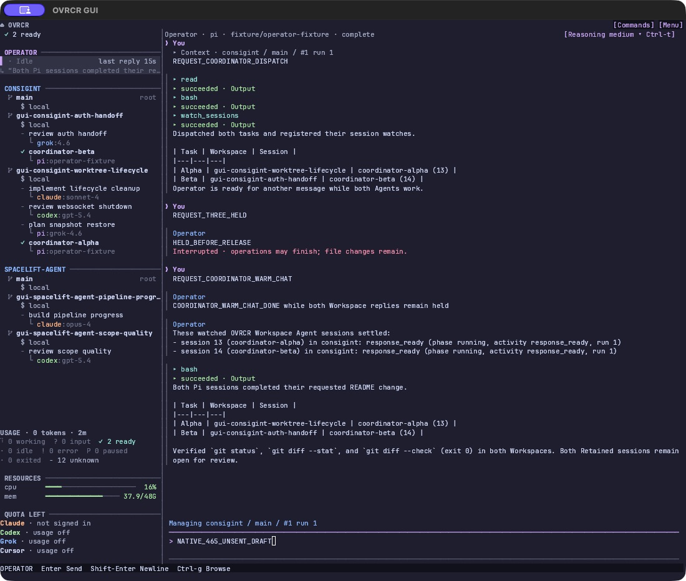

# Operator async session delegation acceptance

[#465](https://github.com/xlyk/ovrcr/issues/465) ·
[PR #471](https://github.com/xlyk/ovrcr/pull/471), merged 2026-11-11 as
`4a5326c5a7f08097ac9d2b7bd2c7b945b4923adc`. Integration branch:
`codex/465-integration`; base `ceb8f06d25096dfb490efca5861532b009b6949f`.

All five ticket implementations and review corrections are integrated. Native
acceptance passed at `1dc1e248f032d04090133ef7177fb620e3551254`. Subsequent
`8c4d1ab3` removes four redundant unit expressions and updates the runtime test
fixture to model the actual soft-stop handshake; feature behavior is unchanged.
Final CI results are recorded below.

## Implementation and focused proof

| Ticket | Behavior | Evidence |
|---|---|---|
| #466 | 50 Workspace slots plus a dedicated Operator slot; generic Operator input/pause fences | Compiled Server/CLI scope 10/10; existing delegation capacity 1/1. New regressions failed on original behavior. [Attempts](466-attempts.md) |
| #467 | Run-scoped warm worker, per-run active Pi file, durable per-turn checkpoints, model/default changes, retirement/shutdown | e2e 17, worker 50, retained 20, migration 14 passed/1 ignored; focused wire/UI/CLI/Reporter checks. [Attempts](467-attempts.md) |
| #468 | Bounded deterministic watches, supplied-baseline catch-up, atomic idle wakeup admission, batching, unread and drafts | protocol 6, retained 21, Server Operator 20 passed/1 ignored, Dashboard 32, e2e 18, worker 50. [Attempts](468-attempts.md), [portable UI fixture correction](468-ci-followup.md), [one-shot race barrier](468-ci-race-followup.md) |
| #469 | Leased Stop/failure/timeout rollback, Running until settlement, first-turn/zero-record cases, five-second owned fallback | Six focused compiled Server/fake-Pi cases; real extension same-process resume/queue/in-flight proof; historical Failed JSON round-trip. [Evidence](469-evidence.md) |
| #470 | Private bundled coordinator skill, explicit argv, isolated policy, provider-aware delegation/verification | Materialization/argv 1, HOME guard 1, compaction detector regression 1; installed Pi isolation 1 with 32 filtered; helper build/fmt/diff. [Evidence and native setup](470-evidence.md) |

The above counts identify the staged focused checks. Final hosted CI supplies
the complete workspace regression and lint gate after corrections.

## Native GUI proof

Source `1dc1e248`, unmodified Pi 0.87.1, local scripted provider. Two real managed
Pi sessions on separate worktrees received Paste tasks and held their replies
while Operator completed dispatch and accepted another turn. Ctrl-x stopped
that foreground reply; the next warm chat reused PID 21898/run 1 and its provider
context excluded the stopped prompt/partial answer.

After release, both Reporters advanced revision 1→6. One batched AsyncWakeup
read the replies and inspected Git state/checks. The hidden dock showed 1 unread;
reopening preserved the unsent Quick draft. Both delegates remained open. The
last wakeup released the lease and Operator exited.

[Native evidence](native/README.md) contains five screenshots with matching AX,
JSON baselines, journal summary, Git checks and redacted provider requests.
The GUI/provider exited 0, root/socket were removed, and all 15 owned process
groups were absent. The corrected interruption text was verified in the final native run.
[Final review and resolutions](review.md) include the old-journal compatibility
fix and its production migration/read regression.

## Integration decisions

- Current base source was protocol 84/schema 32; this unreleased PR advances once
  to 85/33. SQLite preserves journals, receipts and sequence values while allowing
  multiple turns per run. Older binaries refuse the newer schema; clients and
  Server need matching wire versions.
- CLI `unread.turn` is an opaque string/null. Watches compare changed non-null
  identity alongside numeric `activity_revision`, preserving the existing CLI.
- The extension confirms atomic Server admission before `sendUserMessage`, so a
  wakeup losing to user Submit retains its reports and starts no model work.
- The existing CLI guide stays system-only. Pi advertises coordinator metadata
  and its private path; its `read` tool loads the skill body on demand.

## Hosted checks

[Final CI run](https://github.com/xlyk/ovrcr/actions/runs/43144163403) passed
**seven jobs** on PR head `541db6a76e6afb594481dfcaee803ab50daf0b1f`;
**three Linux jobs were skipped**. The required workflow runs the four macOS workspace
shards, formatting, Clippy, documentation/extension tests, offline Cursor
preflight, selection audit and aggregate. Linux jobs run only on manual dispatch;
a skipped Linux job is not a pass. The merged PR retains the checked SHA and
outcome. All six feature issues (#465–#470) are closed, with acceptance evidence
and the child checklists reconciled after merge.

Earlier failures and corrections remain in the linked attempt records. The
four-pane terminal gate later passed without source/assertion changes;
[diagnosis](terminal-ci-diagnosis.md) separates observed failures from the
unconfirmed synchronization hypothesis.

[CI corrections](ci-corrections.md): the exact workspace Clippy gate passed;
Server Operator tests passed 20 with 1 ignored. The old fixture terminated on
SIGUSR1 instead of acknowledging AbortTurn and Retire. Controlled-stop assertions
remain, with a bounded wait for the separate retirement proof.

The [wire snapshot correction](ci-wire-snapshot.md) adds the intentionally new
`AbortTurn.leased=false` byte to EXPECTED. The owning snapshot passes; the shared
protocol version remains 85.
